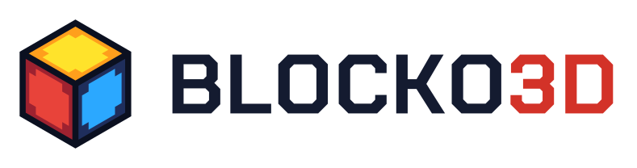

<h1><picture>
  <source media="(prefers-color-scheme: dark)" srcset="brand/logo/blocko3d-horizontal-on-dark.svg">
  
</picture></h1>

A small, deliberately limited 3D game engine for JavaScript with a PICO-8-style developer experience. The whole API lives in the global namespace, everything is drawn from 8×8 palette-indexed textures, and the IDE is one static web page: write code, draw tiles, build voxel maps and press **Run**.

**Version 0.1.0-alpha**: ready for testing by real people. It works and has been tested in a browser, but it's had little time on real devices and the API can still change. See [CHANGELOG.md](CHANGELOG.md) for what's in it, and **Testing the alpha** below for how to report problems.

## Brand

BLOCKO3D was called blocky3D until October 2026. The logo, icons, favicon, share image and the wordmark's font (Chakra Petch Bold, SIL Open Font License) are in [`brand/`](brand/), with a [README](brand/README.md) giving the colors and how to use them. Saves, autosaved carts and player settings from the blocky3D days carry over, since their storage keys kept the old name.

## Running it

It's a static site with no build step. ES modules need a web server, so either:

- **Online:** the IDE is live at https://paloblanco.github.io/blocko3d/ (GitHub Pages, deployed from `main`), and the exported demos at https://paloblanco.github.io/blocko3d/standalone_demo/ (a page linking to each one).
- **Locally:** `python -m http.server` in this folder, then open http://localhost:8000.

Everything the IDE uses is in this repo (CodeMirror 5, Three.js 0.170 for the editor previews and the two fonts are in `vendor/`), so it never reaches another website. Games themselves run on the bundled runtime in `runtime/` (see below).

### Installing the IDE (offline, desktop)

The IDE is an installable app. Open it in Chrome or Edge and click the install icon at the right of the address bar (in Safari on a Mac: File → Add to Dock). It opens in its own window, with the BLOCKO3D icon in your dock, taskbar or Start menu, and **works offline**: once it has been opened online, the IDE, the game player, Export, the Info tab and every demo are kept on your computer. When you're online it always loads the latest version and updates its copy. Your autosaved cart is shared with the IDE in a browser tab (same site, same storage); Save and Open still use `.b3d.json` files. The app covers the IDE page only, so the standalone demos stay separate apps you can install on their own.

## Testing the alpha

- **Try the IDE:** open https://paloblanco.github.io/blocko3d/, pick a demo from **Demos**, then press **Run**.
- **Try an exported game:** open https://paloblanco.github.io/blocko3d/standalone_demo/ and pick a demo. Each is exactly what **Export** makes. It's the easiest thing to try on a phone or tablet.
- **Things worth trying:** the touch controls in portrait and landscape, pause, mute, fullscreen and Restart (fullscreen should stay on), a gamepad, and making a small game of your own.
- **When something goes wrong,** please note the version (it's at the top of the Info tab and in the console), your device and browser, whether you were in the IDE or an exported game, and what you did just before.

## The IDE

| Tab | What it does |
| --- | --- |
| Code | Your game's JavaScript (`_init`, `_update`, `_draw`). |
| Map | Paint maps layer by layer, seen from the top, front or side, set size, name and origin, with a 3D orbit preview. Undo and redo with the buttons or Ctrl+Z / Ctrl+Shift+Z. |
| Tile | Draw each tile's three 8×8 textures (top, sides, bottom) with the 32-color palette. |
| Sfx | Make sound effects, PICO-8 style: draw pitches with a brush (waveform, volume, effect), set speed and loop points, play them, and copy a sound out as a string. Turn on **Snap to scale** (default C minor pentatonic; any root and 9 scales) so every note you draw fits the song. |
| Music | Arrange songs: 64 patterns of up to 4 sounds playing at once, with loop start, loop back and stop flags. Play follows the song through the patterns. |
| Scene | Arrange copies of maps and vox markers into a level: add, drag (across the ground or up and down an upright plane), nudge, turn, duplicate and name them in a 3D view, with undo. A game builds it with `scene_load(n)`. |
| Vox | Build 8×8×8 voxel models for characters and items: paint layer by layer (seen from the top, front or side) or click in the 3D view, mirror, set the pivot, outline every voxel in the 3D view, onion-skin the previous model, undo, and play a range of models as an animation. |
| Info | API reference. |

The game runs on the right in a square 256×256 view. Errors show in the console below it; click one to jump to the line. The cart autosaves in your browser; **Save** downloads it as a `.b3d.json` file and **Open** loads one. **Demos** is a menu of sample games to load and pick apart, each showing off a core feature:

| Demo | What it shows |
| --- | --- |
| Castle | The tour: maps, a drawbridge that's a moving map, vox characters with a walk cycle, `pal` recolors, outlines, sound, music, a title card and a saved best time. |
| Block Pop | Click or tap a group of same-colored blocks to pop it. `mouse_ray()` + `mray()` find the block under the cursor; `mget`/`mset` change the map while playing. |
| Tilt Maze | Tilt the maze to roll a marble to the flag. Collision on a rotated map: `mpush` pushes the marble out of a maze that tilts under it, and it bounces off the way it was pushed. |
| Scrambler | A carnival ride of maps spinning on their pivots. One arm map and one car map are each drawn several times a frame; hop in a car for the ride view. |
| First Person | Find the key in a dungeon maze. A first-person camera with mouse capture (or a finger drag), sphere collision, `mray()` to see what you face, gates that are maps of their own, `palt()` for see-through bars. |
| Builder | Build on a plot, block by block. `mray()` and the face it hits to place or dig, a hotbar drawn with `rectfill` and clicked through `mouse_pos()`, the mouse wheel, and the whole build kept with `save()`. |
| Bumper Arena | Bump the other cars off a crumbling platform. Up to 4 players on gamepads (`btn`/`btnp`/`stick` with a player number), the computer driving empty seats, one car model recolored per player with `pal()`, the arena crumbling with `mset()` and coming back each round with `map_reload()`, and hit-stun with a camera shake on hard bumps using `freeze()`. |
| Split Screen Racing | Two cars, three laps. `clip()` splits the screen into two views with their own chase cameras, a minimap view sits on top, text is clipped to each half, and a second gamepad can take over the computer's car. |
| Third Person | Collect stars across floating islands. An orbit camera kept out of walls with `mray()`, movement relative to the camera, and riding a sliding platform, a turning bridge and an elevator with `wtom()`/`mtow()`. |
| Village | Open the houses, collect the coins, reach the flag, over two levels. Each level is a scene from the Scene tab built with `scene_load()`: one house map placed many times (each copy's door opens on its own), `s.named` to find the cage, and vox markers for the start, coins and flag. |

Under the game are **pause**, **mute** and **fullscreen** buttons, the same as in an exported game. While a game runs, **Enter** (or the pause button) pauses it, PICO-8 style, with Resume, Restart (runs the game again from the start, in place, so fullscreen stays on), Screenshot (a PNG of the game screen), **Capture cover** (only in the IDE: makes the current screen the cover art exported games show before they start) and Resolution: 1×, 2× or 3× renders the 3D view at 256, 512 or 768 pixels for smoother edges, with outlines kept at the same thickness. Text and rectangles stay at 256. Under the game, **Save data** shows what the game has stored with `save()` and lets you clear it, and **Cover** shows the captured cover art (Clear removes it).

### On a phone

On narrow screens the IDE shows one panel at a time, and the game gets its own **Game** tab, which **Run** switches to. The game shows the same touch controls as an exported game (see below). In the map editor, pick tile 0 to erase. In the tile and vox editors, the **Pick** tool takes a color from the image, standing in for right-click.

## Exporting a game

**Export** downloads `<gamename>.zip`, named from the cart name in the top bar (lowercased, spaces become dashes). The game itself is two files:

- `index.html`: a page that fills the window with the square game view.
- `<gamename>.js`: the whole engine with Three.js bundled in, plus your cart's tiles, maps, vox models, sounds, music and code. The pause menu, sounds and save data all work in exported games too.

The page around the game has a **pause**, **mute** and **fullscreen** button, on desktop too. On a phone or tablet (or once someone touches the screen) it adds PICO-8-style touch controls: a d-pad and O and X on either side of the game in landscape, or under it in portrait. They're HTML around the game, never drawn on it, and you can restyle them with your own `<style>` in `index.html`.

An exported game opens on its **cover**: the cover art captured in the IDE (or, without one, the game's name) with a play button. Nothing loads until the player clicks or taps the game, presses a key, or presses A or Start on a gamepad, so a page with your game on it costs nothing for someone just scrolling past, and sound can start right away.

The zip also holds four small files that make the game an **installable app** (a PWA) when it's hosted on an https site, such as your own site, GitHub Pages or Netlify: `manifest.webmanifest`, `sw.js`, `icon-192.png` and `icon-512.png`. The icons are made from the cover art, or from the game's name without one. Players can then put it on their home screen (Android: Install app; iPhone and iPad: Share, Add to Home Screen) or install it on a computer (Chrome or Edge: the install icon in the address bar; Safari on a Mac: File, Add to Dock), where it gets its own window and a place in the Start menu, dock or app launcher. It opens full screen, without the browser around it, and works offline after the first visit. Upload a new export and players get it the next time they open the game online. Two things to know: on itch.io and Game Jolt the game runs inside their page, so it can't be installed from there (the extra files do no harm). And on iPhone, the home-screen app keeps its own save data, separate from Safari's.

The game needs nothing else: no network, no server. It works when opened straight from disk, embedded in a page, or uploaded as an HTML game to itch.io or Game Jolt (upload the zip as-is). If the game hits an error, the message is shown on screen. Export refuses to run if the code has a syntax error. The four app files are only used on https sites, so the game runs the same with or without them.

## Making a game with an AI chatbot

Any chatbot, free ones included, can write a whole BLOCKO3D game. Ask for the game you want and give it this link first: **https://paloblanco.github.io/blocko3d/llms.txt**. That one page tells it everything it needs: write a single JavaScript file, build the levels in code with `map_box`, and use the art and sounds of the **Starter** cart. You then pick **Starter** from the IDE's Demos menu, paste the code into the Code tab, and press Run.

The Starter cart has 16 named tiles (grass, brick, lava, a bounce pad…), 9 vox models (a walking hero, a guard, a coin, a flag, a tree…), 8 sound effects and a song, plus a small platformer to change. `llms.txt` is made by the build from `tools/llms.md` and the Starter cart, so its list of assets and its example code always match the cart.

## Making games outside the IDE: the `b3d` command

`b3d` does the IDE's jobs from a terminal, for a text editor, git, scripts or an AI agent:

```
npm install -g github:paloblanco/blocko3d     # Node 18 or later
b3d unpack game.b3d.json game/                # a cart saved by the IDE -> a folder of small text files
b3d check game/                               # every limit and format; problems name the file and line
b3d shot game/ --frames 300 --input "o@30, up:60-200" --out walk.png   # run headless, save the screen
b3d run game/ --frames 600                    # the same, printing printh output
b3d render game/ --map 0 --view top           # pictures of one map, model (--vox n) or all tiles (--tiles)
b3d sfx render game/ --music 0                # a sound or the song to a WAV, with its levels
b3d pack game/                                # back to game.b3d.json, exactly as the IDE's Save writes it
b3d export game/ --zip                        # the same zip as the Export button
```

A game can live as a **project folder**: `main.js` for the code, one text file per tile, model and sound (pictures drawn with one character per pixel), `music.txt`, raw map files or scripts that build maps, and `cart.json` for the rest. `pack` and `unpack` turn it into a cart and back without losing anything, so the IDE and a text editor can take turns on one game. Headless runs step the game exactly one update at a time with a fixed seed, so they repeat. `shot`, `run` and the map and model renders need Playwright (`npm install -g playwright`, then `npx playwright install chromium`).

[MAKING_GAMES.md](MAKING_GAMES.md) describes the folder and every command (`b3d docs` prints it). There's also `b3d info` (every asset on one screen), `b3d map --at x,z` (what's in a column and where you can stand), `b3d api <name>`, `b3d new`, and test hooks for headless runs: `--eval`, `--at 50:"code"` and `--watch "expr"`.

## A tiny cart

```js
function _init() {
  bg(12)
}

function _draw() {
  cam_set_pos([8, 10, -6])
  cam_set_lookat([8, 0, 8])
  map(0)
  sphere(8, 4, 8, 0.5, 10)
  print('Hello!', 4, 4, 7, 0)
}
```

## API at a glance

- **Loop:** `_init()`, `_update()` (60 per second), `_draw()` (immediate mode). `freeze(n, fn)` runs `fn` (or nothing) instead of `_update` for the next `n` updates while `_draw` keeps going: hit-stun in one line.
- **Maps:** `map(m)` (`map(m, true)` also draws faces' backs, for see-through tiles), `map_new`, `map_set_pos`, `map_set_angle` (turns; yaw, then pitch, then roll), `map_set_origin` (keeps the map in place), `mget`, `mset`, `mgetw` (point or sphere query with push-out), `mpush` (collision in one call: push a sphere out of one or more maps, and learn which way and what you stand on), `msetw`, `mray` (first block along a ray), `mtow` / `wtom` (a point on a map's grid to the world and back, for things attached to moving maps), `map_reload` (put a cart map's blocks back as the cart has them, or all of them), `map_copy` (a new map with its own copy of the blocks), `map_stamp` (copy one map's blocks into another), `map_box` (fill or carve a box of blocks: a level in a few lines of code).
- **Scenes:** `scene_load(n)` builds a scene from the Scene tab and returns `{ maps, named, things }`: fresh, already placed map copies to draw and collide with, the ones you named, and the vox markers (`[v, x, y, z, yaw]`) for your code to turn into the player, pickups and so on.
- **Vox models:** `vox(n, x, y, z, pitch, yaw, roll, sx, sy, sz)` draws model n (8×8×8 voxels = 1 block) at its pivot; everything after the position is optional. Animate by swapping models, or by drawing a character from parts.
- **Primitives:** `cube`, `sphere`, `line3`.
- **Palette:** `palette[i]` (global, 32 colors), `pal(a, b)` and `pal()` (per-draw remap), `palt(i, on)`, `bg(c)`.
- **Outlines:** `outline(c)` / `outline()`, per draw like `pal`; 1-pixel outlines that follow what's on screen; on maps and vox models, every visible edge is outlined. `outline(c, false)` draws only the outer outline, for round shapes. Off by default.
- **Camera:** `cam_set_pos`, `cam_set_lookat`, `cam_set_fov` (in turns, across the longer side of the view, default 0.25).
- **Clipping and split screen:** `clip(x0, y0, x1, y1)` limits drawing (3D, text and rectangles) to a rectangle, and `clip()` lifts it. Each `clip()` starts a new 3D view with its own camera, centered in its rectangle, so two halves of the screen can follow two players, and a small view drawn last makes a minimap or mirror.
- **Text and UI:** `print(str, x, y, c, oc, sx, sy)`, a 7×10 pixel font with upper and lower case; `oc` adds an outline, `sx`/`sy` scale it by whole numbers for titles. `rect` and `rectfill(x0, y0, x1, y1, c)` draw outlined or filled boxes on the same layer, PICO-8 style.
- **Sound:** `sfx(n, ch, offset, length)` plays sound n (0-63) from the Sfx tab on one of 4 channels; `sfx(-1)` stops, `sfx(-2, ch)` ends a loop.
- **Music:** `music(n, fade)` plays the song from pattern n of the Music tab (fade in milliseconds); `music(-1, fade)` stops.
- **Save data:** `save(value)` stores any JSON value for this game in the browser; `load()` reads it back.
- **Input:** `btn(i, p)` / `btnp(i, p)` for up to 4 players, PICO-8 style: player 0 is the keyboard plus the first gamepad, and the 2nd-4th gamepads are players 1-3. Buttons 0-5 work everywhere; 6-18 are the rest of a modern gamepad (Start, A/B/X/Y, bumpers, triggers, Select, stick clicks, Home). `stick(i, p)` returns a stick as `[x, y]`. `touch_set_mode(n)` picks the touch control phones show on the left: 0 d-pad, 1 analog circle (feeds `stick(0)`), 2 left/right, 3 up/down.
- **Mouse and touch:** off by default. `mouse_set_mode(1)` for pointing and clicking, `mouse_set_mode(2)` to capture the mouse for mouse-look (losing it pauses the game). Mouse buttons are `btn(19)`, `btn(20)`, `btn(21)`; also `mouse_pos()`, `mouse_delta()`, `mouse_wheel()`, `mouse_locked()`, and `mouse_ray()`, which with `mray` finds the block under the cursor. On touch screens a tap is a click (mode 1) and dragging is mouse movement (mode 2).
- **Helpers for 3D games:** `dist(a, b)` (arrays or `{x, y, z}` objects), `dir3(yaw, pitch)` (the direction for an angle), `yaw_to(dx, dz)` (the angle for a direction), `angdiff(a, b)` (the shortest turn between two angles), `lerp(a, b, t)` (numbers or arrays), `cam_orbit(target, yaw, pitch, dist)` (an orbit or chase camera in one call), and `printc`/`textw` for centered and measured text.
- **Extras:** `printh`, `time`/`t`, `rnd`, `srand`, `flr`, `sin`, `cos`, `atan2`, `mid` and friends.

The Info tab has the full reference, and [docs/API.md](docs/API.md) has the same as one Markdown page (made from the Info tab by the build).

## How it works

- `js/core.js`: palette, tile atlas, voxel meshing, map transforms and the shaders. Tile textures store palette indices; a shader remaps each index through the current `pal()` table, then looks up the real color in a 32-entry palette shared by every material. So changing `palette[i]` recolors maps, primitives and the background on the next frame.
- `js/engine.js`: the runtime and the global API.
- `js/boot.js`: installs the API as globals and starts a cart; shared by Run and exported games.
- `js/shell.js`: the page around the game: layout, touch controls, and the pause, mute and fullscreen buttons.
- `runtime/blocko3d.runtime.js`: the engine, boot code and Three.js bundled into one plain script (`window.Blocko3D`). Both **Run** and **Export** use this file, so what you test is what you ship.
- `player.html`: runs a cart inside an iframe, so every press of **Run** starts clean. The pause menu's Restart runs the cart again in place, in the IDE and in exported games alike.
- `js/export.js`, `js/zip.js`: build the export zip in the browser, with no dependencies.
- `index.html`, `js/ide.js`, `css/ide.css`: the IDE. `js/preview.js` is the orbit viewer used by the editors.
- `js/audio.js`: the sound synth (8 waveforms, 8 effects, loops), the sound and pattern string formats, a 4-channel sfx player and the music scheduler; used by the game and the Sfx and Music tabs.
- `js/cart.js`: cart format and the castle demo, generated in code.
- `demos/`: the carts in the **Demos** menu, each an ordinary `.b3d.json` file, listed in `demos/index.json`.
- `js/version.js`: the version number shown in the IDE and exported games.

## Adding a demo

1. Make the game in the IDE and press **Save** to download its `.b3d.json` file.
2. Put the file in `demos/`.
3. Add a line for it to `demos/index.json`: the file name, the name shown in the menu, and a sentence about what it shows (shown as a tooltip and in the console when it loads).

That's enough for the IDE's menu online. Then run `npm run build` (see **Building** below) and commit what it writes: it exports every demo in the list to its own page in `standalone_demo/<name>/` and rebuilds the list page `standalone_demo/index.html`, so the demo can be played on its own, on a phone too, and adds the new cart to the installed IDE's offline files. The castle is generated in code (`js/cart.js`), and the build also writes it to `demos/castle.b3d.json`, with its cover art from `demos/castle-cover.png`. The list page shows each demo's cover.

## Building (after any change)

Working on the engine itself? [docs/ENGINE.md](docs/ENGINE.md) has the design decisions, the architecture and what's been tested.

**Run `npm run build` before every commit, whatever you changed**, and commit what it rewrites along with your change:

```
npm install      # once
npm run build    # rewrites runtime/, standalone_demo/, demos/castle.b3d.json, docs/API.md and the IDE's offline files
```

The IDE itself runs as plain files with no build step, but the build keeps four things in step with your change:

- **The runtime bundle**, `runtime/blocko3d.runtime.js`, made from the engine (`js/core.js`, `js/engine.js`, `js/font.js`, `js/audio.js`, `js/shell.js`, `js/boot.js`, `js/version.js`). Run and Export use it, so engine changes don't show up until you rebuild.
- **The demos.** The castle (generated in `js/cart.js`) is written to `demos/castle.b3d.json`, and every demo in `demos/index.json` is exported to `standalone_demo/`, with a page listing them (open `standalone_demo/index.html` on the site to try an exported game).
- **The API reference**, `docs/API.md`, made from the Info tab's text in `js/apidocs.js` by `tools/build-docs.mjs`. Edit `js/apidocs.js`, not the Markdown.
- **The installed, offline IDE.** `ide-sw.js` (the service worker) and `ide.webmanifest`. `ide-sw.js` lists every file the IDE uses with a fingerprint of their contents, so it changes whenever any of them does (`index.html`, `player.html`, `css/`, `js/`, `demos/`, `vendor/`, `runtime/`). That's how installed IDEs know to download the new files. **This is why a change that only touches the IDE, like a CSS tweak, a new demo or an Info tab edit, still needs the build**: without it, installed IDEs won't keep the new files for offline use. If you add a new top-level folder the IDE loads files from, also add it to `SOURCES` in `tools/build-ide.mjs`.

A GitHub Action fails if any of these committed files doesn't match a fresh build.

## Not in this version

- A built-in way to ride moving or rotating maps: games do it in a few lines with `wtom` and `mtow` (the Third Person demo shows how).
- Undo in the Tile editor (the Map, Vox and Scene tabs and the code editor have it).
- Editing the palette in the IDE (change `palette[i]` from code for now).
- Custom pause menu items (PICO-8's `menuitem`) and analog trigger values.
- Fullscreen on iPhone Safari, which doesn't allow it. Real iPhones and iPads haven't been tested yet.
