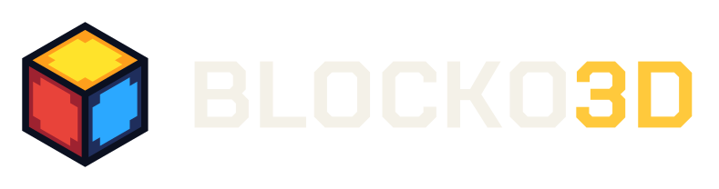

# BLOCKO3D brand assets

Logo, icon and web assets for BLOCKO3D. All SVGs are self-contained: the wordmark is converted to outlines, so no font needs to be installed to display them.

## What's in here

| Folder | Files | Use for |
|---|---|---|
| `logo/` | `blocko3d-horizontal-on-dark` (.svg, .png, @2x.png) | Site/IDE header on the navy UI |
| | `blocko3d-horizontal-on-light` | Light backgrounds, docs, README badges |
| | `blocko3d-stacked-on-dark` / `-on-light` | Title / splash screens, square spots |
| `icon/` | `blocko3d-cube.svg` + PNGs (64–512) | The cube alone, transparent background |
| | `blocko3d-cube-tile.svg` + PNGs (64–512) | Cube on a navy square (itch.io / Game Jolt avatars, app icons) |
| `web/` | `favicon.svg`, `favicon.ico` (16/32/48) | Browser tab icon |
| | `apple-touch-icon.png` (180), `icon-192.png`, `icon-512.png` | Home-screen / PWA icons |
| | `og-image.png` (1200×630) | Social link preview |
| `font/` | `ChakraPetch-Bold.ttf`, `OFL.txt` | Wordmark typeface, for UI text if wanted (SIL Open Font License) |

Logo files have transparent backgrounds; pick the `on-dark` or `on-light` version to match what's behind it.

## Dropping it into the site

Copy `web/*` to the site root, then in `<head>`:

```html
<link rel="icon" href="favicon.ico" sizes="any">
<link rel="icon" href="favicon.svg" type="image/svg+xml">
<link rel="apple-touch-icon" href="apple-touch-icon.png">
<meta property="og:image" content="og-image.png">
```

Header logo (replaces the current text wordmark):

```html

```

For a PWA manifest, use `icon-192.png` and `icon-512.png`.

## Colors

| Role | Hex |
|---|---|
| UI background (navy) | `#141B30` |
| Cube outline (ink) | `#0B1020` |
| Wordmark on dark | `#F4F1E8` |
| "3D" accent on dark | `#FFC93C` |
| Wordmark on light | `#141B30` |
| "3D" accent on light | `#D33228` |

Cube faces (each is an 8×8 pixel texture: a frame color with a notched inner square):

| Face | Frame | Inner |
|---|---|---|
| Top (yellow) | `#FF9F1C` | `#FFE32B` |
| Left (red) | `#9E2230` | `#E8433A` |
| Right (blue) | `#1F2E5C` | `#2BA8FF` |

Inner-square pixels on the 8×8 grid (`.` = frame, `#` = inner):

```
........
..####..
.######.
.######.
.######.
.######.
..####..
........
```

This doubles as a block texture if you want the logo cube to exist in-engine.

## Type

Wordmark: **Chakra Petch Bold**, letter-spacing 0.02em, all caps, with "3D" in the accent color. Available on Google Fonts if you'd rather load it than bundle it.

## Usage notes

- Keep clear space around the logo of at least half the cube's width.
- Don't rotate or tilt the cube, recolor the faces, or set the wordmark in another font.
- At 32 px and below, use the cube alone rather than the full logo.
